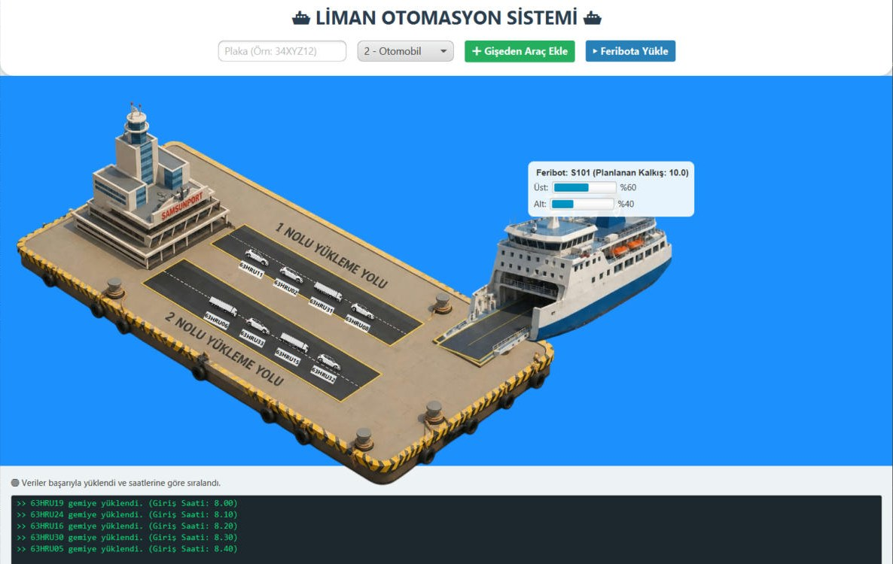

# Port & Ferry Simulation – Custom Data Structures in Java

A JavaFX simulation of vehicles waiting at a port and being loaded onto ferries. Every data structure in it – queue, stack and hash table – is written from scratch instead of using `java.util` collections.

  

> Team project (2 people) for the Data Structures course at Bingöl University.



## How the simulation works

```
Arac.txt ──▶ plate check (hash table) ──▶ Road 1 / Road 2 (queues, FIFO) ──▶ Ferry
                                                                              ├── lower deck (stack, 5 vehicles)
Feribot.txt ──▶ ferry schedule                                                └── upper deck (stack, 5 vehicles)
```

| Structure | Class | Used for | Why this structure |
|---|---|---|---|
| Queue (linked list) | `Kuyruk` | The two waiting roads | Vehicles board in arrival order – first in, first out |
| Stack (array, capacity 5) | `Yigin` | Each ferry deck | The last vehicle driven onto a deck is the first one off |
| Hash table (separate chaining) | `HashTablosu` | Registered licence plates | Rejects duplicate plates with an average O(1) lookup |

The hash table uses a polynomial string hash (`hash * 31 + char`) over 50 buckets, with linked-list chaining for collisions.

## Project structure

```
src/main/java/com/example/mainfx
├── HelloApplication.java   JavaFX UI and simulation flow
├── Kuyruk.java / AracDugum.java     queue + node
├── Yigin.java                        stack
├── HashTablosu.java / PlakaDugum.java   hash table + chain node
├── Arac.java                         vehicle
└── Feribot.java                      ferry with two decks
Arac.txt, Feribot.txt   input data (vehicles, ferry schedule)
```

## Run it

**Requirements:** JDK 20+ (Maven wrapper and JavaFX 20 are configured in `pom.xml`)

```bash
./mvnw clean javafx:run
```

## My part

- Designed the project structure – separating the simulation logic, the data structures and the UI
- Implemented the queue, stack and hash table
- Built the JavaFX screens that show the roads, the ferries and the loading process

## Authors

**Ahmed Al-Gabri** – [LinkedIn](https://www.linkedin.com/in/ahmed-al-gabri) · [GitHub](https://github.com/ah24aki)  
Co-author: [@mahmutaziz](https://github.com/mahmutaziz)
